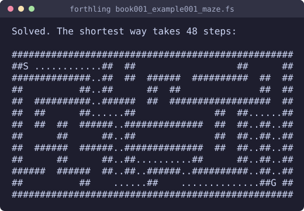
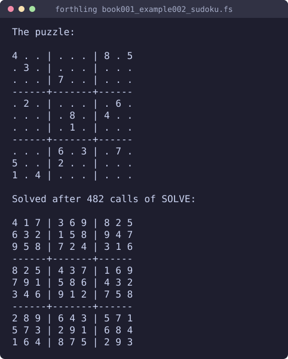
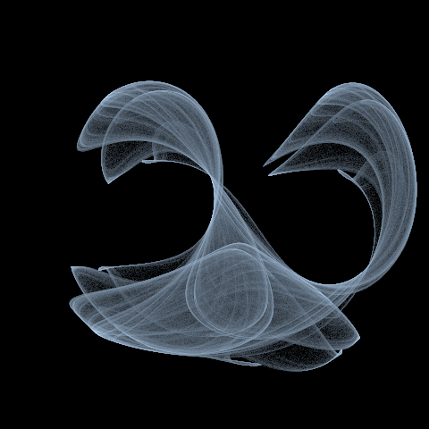
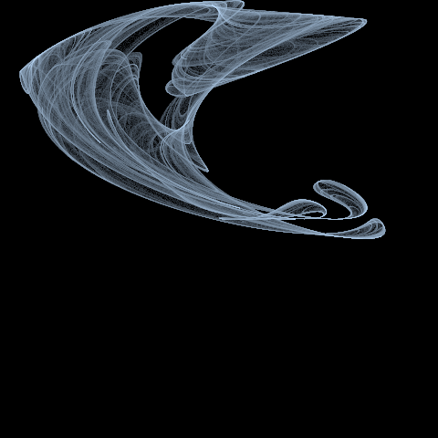

# forthling

[](https://github.com/DeSchaker/forthling/actions/workflows/ci.yml)

> **forthling** *(noun)*
>
> 1. A diminutive creature thriving on a two-stack diet.
> 2. A lean, extensible Forth system built from the ground up.

Forth is a tiny language with a big idea: you build your program out of small words, and
you can try each one the moment you write it. forthling brings that to today's world: a
complete [Forth-2012](https://forth-standard.org/) system in Rust that you can run on the
command line, build into your own program, hand to an AI agent, or
**[try right now in your browser](https://deschaker.github.io/forthling/)**, with nothing
to install.


## Why forthling

- **The whole standard.** All word sets of Forth-2012, from CORE to FLOATING, pass the
  Forth-2012 test suite, so standard code from books and tutorials runs as written. See
  [Standard compliance](docs/language.md#standard-compliance).
- **Safe to play with.** A sandbox puts limits on steps, time and output, and keeps the
  disk out of reach: files live in memory there, so a program can still write, read and
  `INCLUDE` them. A runaway loop stops with an error instead of hanging, and gives the same
  result on every machine. See [Sandbox](docs/embedding.md#sandbox).
- **Small and clean.** The core has no dependencies and no `unsafe`, and its memory is
  bounded.
- **Talks to the world.** JSON, strings, vectors and dictionaries, fixed-point numbers and
  a canvas for pictures in the core; SQLite, regular expressions and HTTP as extensions.
- **Made for AI agents.** An [MCP server](docs/hosts.md#for-ai-agents-mcp) gives an agent a
  Forth session that remembers its definitions and shows the stacks after every call. When
  something goes wrong, it also says where, which words were running and what the stacks
  held, so an agent can often fix its code in one round. [`llms.txt`](llms.txt) tells a
  language model how to use it.
- **Learn as you go.** `ALSO TUTORIAL` gives 20 short lessons, ten for beginners and ten
  beyond, and `CHECK` tests your answer. See [Tutorial](docs/tools.md#tutorial).
- **Runs anywhere.** As a program, embedded in [Rust](docs/embedding.md) or
  [Python](docs/hosts.md#from-python), or [in the browser](https://deschaker.github.io/forthling/)
  through WebAssembly.

## A first try

Install the program from [crates.io](https://crates.io/crates/forthling) with Rust 1.85 or
newer, and run `forthling`:

```
cargo install forthling
```

From a clone of the repository, `cargo run --release` does the same:

```
$ cargo run --release
forthling — WORDS shows the dictionary, BYE quits.
: SQUARE  DUP * ;
 ok
7 SQUARE .
49  ok
```

A word is a name for a piece of code; `SQUARE` takes a number from the stack and leaves its
square. Run a file with `cargo run --release -- examples/book000_example001_demo.fs`. The
other ways to install it, and the options of the program, are in
[Install and options](docs/install.md).

## What you can make

Every picture here comes from a program in [`examples/`](examples/), run for real; the
cookbook explains how each one works. `node docs/make-pictures.mjs` makes them again.

| | |
|---|---|
| <br>The Mandelbrot set, with fixed-point numbers on the canvas | <br>A Julia set, from the same program |
| <br>A maze, made and solved | <br>A sudoku, solved by backtracking |
| <br>The Clifford attractor: three million jumps of one point, shaded by how often each pixel was hit | <br>A De Jong attractor: the same counting, another jump and four numbers |

The [cookbook](cookbook/) has complete programs on puzzles, pictures, and data and tools
(JSON, word counts, templates), each with a chapter that explains it, and a guide,
[Forth for people who know Python](cookbook/guide001_python.md).

## Where to go next

| You want to | Read |
|---|---|
| Learn Forth | the tutorial in the program (`ALSO TUTORIAL`, [details](docs/tools.md#tutorial)), or the [cookbook](cookbook/) |
| See what the language offers | [The language](docs/language.md) |
| Use JSON, strings, collections, fixed-point numbers, images or the operating system | [Word lists](docs/wordlists.md) |
| Test, trace and debug your code, or ask `HELP` | [Tools](docs/tools.md) |
| Run it in the browser, from an AI agent, from Python, with SQLite, regular expressions or HTTP | [Where forthling runs](docs/hosts.md) |
| Run code you do not trust, add words in Rust, read error reports | [Embedding in Rust](docs/embedding.md) |
| Know how it follows the standard | [Standard compliance](docs/language.md#standard-compliance), [`COMPLIANCE.md`](COMPLIANCE.md) (Dutch: [`VERKLARING.md`](VERKLARING.md)) |

The extensions (Python, SQLite, regular expressions, HTTP, MCP, WebAssembly, a native
window) live in crates of their own. MIT licence.

## Contributing

Bug reports, ideas and pull requests are welcome; see [CONTRIBUTING.md](CONTRIBUTING.md)
and the [code of conduct](CODE_OF_CONDUCT.md). Security problems go through
[SECURITY.md](SECURITY.md). The open work is in the
[issues on GitHub](https://github.com/DeSchaker/forthling/issues). How to run the tests is
in [CONTRIBUTING.md](CONTRIBUTING.md#testing).

## License

[MIT](LICENSE)
